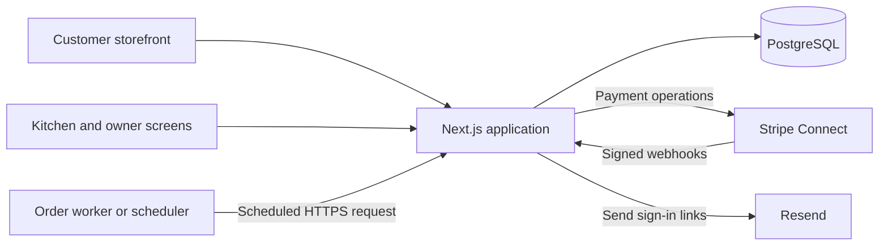

# Siamsil Restaurant

Multi-tenant restaurant ordering platform with a storefront, staff kitchen queue, Stripe Connect payments, and owner controls for menus, hours, pricing, and reports.

## Architecture

Siamsil-SROS is a **modular monolith**. One Next.js application serves the customer storefront, kitchen, owner screens, and HTTP APIs. PostgreSQL holds order and payment state and enforces restaurant-level isolation.



| Component | Responsibility | Stack |
| --- | --- | --- |
| Application | Routes, access checks, menu management, checkout, kitchen workflow, and reports | Next.js App Router, React, TypeScript |
| Data | Restaurants, menus, orders, payment history, sessions, and shared rate limits | PostgreSQL 16, Drizzle, SQL migrations |
| Payments and email | Connected-account card authorizations, captures and refunds, plus staff sign-in email | Stripe Connect, Resend |
| Order maintenance | Release unanswered card holds, reconcile pending refunds, and purge expired runtime data | Node.js worker or managed scheduler calling a protected route |

See the [architecture guide](docs/architecture.md) for checkout and sign-in flows, tenant isolation, and scaling trade-offs.

## Run it

Requires Node 22+ and PostgreSQL 16.

```bash
npm install
cp .env.example .env            # edit passwords for anything beyond local development

# One-time database setup (as a Postgres superuser)
#   create role siamsil_owner login password '...' createdb;
#   create role siamsil_app   login password '...';
#   create database siamsil owner siamsil_owner;

npm run db:migrate              # applies db/migrations using the owner role
npm run db:seed                 # demo restaurant + owner login (SEED_OWNER_EMAIL)
npm run dev                     # http://localhost:3000, sign in at /login
npm test                        # needs a second database named siamsil_test (same roles)
```

In development the sign-in link is printed in the server console instead of being emailed.

## How tenant isolation works

- The running app connects as `siamsil_app`, which does not own the tables, so row-level security applies to it.
- Restaurant queries run inside `withTenant(restaurantId, ...)` in `lib/db.ts`, which sets `app.restaurant_id` for that transaction only. No tenant set means no rows.
- Composite foreign keys `(id, restaurant_id)` stop a row from pointing at another restaurant's row.
- Every restaurant gets a default location. Checkout records that location on new orders.
- The app role cannot create or delete restaurants. Use the owner connection or admin tooling.
- `tests/tenant-isolation.test.ts` proves the above against a real database.

## API (all under /api)

| Route | Who | Purpose |
| --- | --- | --- |
| POST auth/request | public, rate limited | Email a one-time sign-in link |
| GET auth/verify?token= | public | Show sign-in confirmation |
| POST auth/verify | public | Spend the link and set the session cookie |
| POST auth/logout | signed in | End the session |
| GET staff/me | staff | Who am I |
| GET staff/menu | staff | Full menu with items and modifiers |
| POST, PUT, DELETE staff/menu/categories[/id] | owner | Categories |
| POST, PUT, DELETE staff/menu/items[/id] | owner | Items (delete is soft) |
| PATCH staff/menu/items/id/availability | staff | Mark sold out or back in stock |
| POST staff/menu/items/id/modifier-groups | owner | Add a modifier group |
| PUT, DELETE staff/menu/modifier-groups/id | owner | Edit or remove a group |
| POST staff/menu/modifier-groups/id/options | owner | Add an option |
| PUT, DELETE staff/menu/modifier-options/id | owner | Edit or remove an option |
| POST staff/images | owner | Upload a food photo (raw JPEG, PNG or WebP body, up to 1.5 MB). Returns its id and URL |
| GET images/id | public | A food photo, cached for a year |
| POST staff/pos/quote, staff/pos/orders | staff | Price and place an order at the till (custom discounts: owner only) |
| GET staff/orders/id | staff | An order's receipt |
| GET, POST staff/promos; PUT, DELETE staff/promos/id | owner | Promo codes |
| GET, POST staff/tables | staff, owner | Table board with live status; add tables (owner) |
| PUT, DELETE staff/tables/id | owner | Edit, deactivate or delete a table |
| POST staff/tables/id/clear, /qr | staff, owner | Clear a table after payment; replace its QR code (owner) |
| POST, PUT, DELETE staff/floors[/id] | owner | Floors |
| POST staff/table-requests/id/resolve | staff | Mark a guest request done |
| POST staff/orders/id/pay | staff | Record an in-person payment (cash, card machine) on a pay-later order |
| GET t/token | public | A scanned table's restaurant and options |
| POST t/token/checkout, /requests | public | Table order (pay now or pay later); call a waiter or ask for the bill |
| GET r/slug/menu | public | Storefront menu, open/closed state, earliest pickup |
| GET r/slug/pickup-slots | public | 15-minute pickup times (empty when paused or closed) |
| POST r/slug/quote | public, rate limited | Price a cart on the server: subtotal, tax, tip, total |
| GET staff/settings | staff | Ordering settings |
| PATCH staff/settings | staff (pause) / owner (rest) | Pause ordering, prep time, advance days, tax rate |
| GET, PUT staff/hours | staff / owner | Weekly opening periods |
| POST r/slug/checkout | public, rate limited | Start checkout. Reuse `Idempotency-Key` and any `Checkout-Session` header for an identical retry |
| GET orders/token | private link | Customer's order status (polled every 5 seconds) |
| POST webhooks/stripe | Stripe signature | Payment events, de-duplicated |
| GET staff/orders?offset= | staff | Paginated waiting, accepted and ready orders |
| POST staff/orders/id/accept, decline | staff | Accept (with optional `prepMinutes`) captures the money; decline releases the hold |
| POST staff/orders/id/ready, complete | staff | Kitchen line: accepted, ready, picked up |
| POST staff/orders/id/cancel | owner | Cancel an accepted order and refund in full, including the SROS fee |
| GET staff/pricing?monthlySalesCents=&avgOrderCents= | owner | Plans, the active one, and each plan's monthly cost estimate |
| PUT staff/pricing | owner | Choose a plan; applies to new orders only |
| GET staff/reports/summary?days= | owner | Sales, tax, tips, fees, refunds, top items, by day |
| POST internal/expire-orders | `CRON_SECRET` | Release orders unanswered after 5 minutes. Call every minute |

## Decisions made in Sprint 1

- Data access: Drizzle with SQL migrations as the source of truth (no engine download, simple to inspect).
- Login: emailed one-time link, hashed tokens, 15-minute links, 30-day sessions.
- Staff roles: `owner` manages the menu, `staff` can read it and mark items sold out.

## Before any live use

- Set an HTTPS `APP_URL`, a `RESEND_API_KEY`, and a verified Resend sender in `LOGIN_FROM_EMAIL`. A mail link opens a confirmation page and is spent only after submitting it.
- Run migrations during the deployment window before replacing the old app. The auth migration revokes the old runtime role's direct table access.
- Generate independent random values of at least 32 characters for `ORDER_TOKEN_SECRET` and `CRON_SECRET`. Keep the order secret stable for retries.
- Set `TRUSTED_CLIENT_IP_HEADER` to a single-IP header owned and overwritten by your ingress. In Coolify, set this only after confirming that traffic reaches the app through the trusted Cloudflare and proxy path and that the origin rejects direct public traffic. When no trusted IP is available, public rate limits share an anonymous bucket. Production `GET /api/health` reports this configuration as degraded when the header name is missing or invalid. Redact bearer tokens in sign-in and order paths from production access logs.
- Run `npm run worker:orders` under a process supervisor, or use a managed scheduler to call the expiry endpoint every minute. The worker also reconciles pending Stripe refunds and purges expired sessions, login links and rate-limit records. Monitor worker logs and failed webhook deliveries.
- Owners edit the menu at `/menu` and weekly hours and ordering settings at `/manage` (see "Menu editor and photos").
- Point an uptime monitor at `GET /api/health` and optionally set `ALERT_WEBHOOK_URL` for throttled operational alerts. The health check tests database access and flags a worker heartbeat or expiry backlog older than five minutes.
- Existing Sprint 6 deployments can continue using `EMAIL_PROVIDER=resend` and `EMAIL_FROM`. `LOGIN_FROM_EMAIL` takes precedence when both sender settings are present.

## Decisions made in Sprint 2

- The storefront lives at `/r/<slug>`. Prices are never trusted from the browser; `lib/cart.ts` prices from the live menu.
- Tax is rounded half up on the food subtotal. Tips are not taxed.
- Pickup slots are every 15 minutes, from now plus prep time, inside opening hours, in the restaurant's time zone (daylight saving tested).
- Any staff member can pause online ordering; only owners change hours, prep time and tax rate.
- The cart is kept in the browser's local storage.

## Decisions made in Sprint 3

- Stripe Connect direct charges: the payment lives on the restaurant's own account and SROS takes an application fee. Cards are authorized first and captured when the kitchen accepts.
- Fee base is the food subtotal. With direct charges the restaurant's own account pays Stripe, so the "all-in" model takes the target percentage minus estimated processing (never below zero). The exact calculation is saved on every order.
- The kitchen has 5 minutes to accept. After that the hold is released automatically.
- Tips are optional, untaxed, and not part of the fee base.
- Guest checkout needs only a name and phone. The customer's order link is derived from the saved order's server-generated ID. Only its hash is stored. An identical checkout retry returns the same link.
- Webhook events are recorded in the same transaction that applies them, so repeats are ignored and failures can be retried.
- `PAYMENTS_PROVIDER=fake` runs everything locally with a test panel instead of a card form. It refuses to start in production.

## To run against the Stripe sandbox

1. Create a Stripe test account and enable Connect. Create a test connected account for the demo restaurant and save its id in `restaurants.stripe_account_id`.
2. Put the test secret and publishable keys in `.env`, and set `PAYMENTS_PROVIDER=stripe`.
3. Add a Connect webhook endpoint for `/api/webhooks/stripe` listening to `payment_intent.amount_capturable_updated`, `payment_intent.succeeded`, `payment_intent.canceled` `payment_intent.payment_failed`, `refund.created`, `refund.updated`, and `refund.failed`. Put its signing secret in `STRIPE_WEBHOOK_SECRET`. For local testing use `stripe listen --forward-connect-to`.
4. Run the order worker, or schedule `POST /api/internal/expire-orders` every minute with `Authorization: Bearer $CRON_SECRET`.

Before taking live payments, verify card decline and retry, delayed webhook delivery, manual capture, order expiry, and app-initiated full refunds in the Stripe sandbox. Operational reports record captures and confirmed in-app refunds when they occur. Partial refunds and refunds issued outside the app require reconciliation against Stripe.

## Sprint 4: kitchen screen

- `/kitchen` shows new orders with a response countdown, accept with a prep time, mark ready, picked up, and (owners) cancel with a full refund.
- Sound: browsers only allow audio after a tap, so staff press "Turn on sound" once per session. A double beep repeats every 8 seconds while any order is waiting, and the tab title shows the count.
- Staff can pause or resume online ordering from the same screen.
- The screen polls every 4 seconds. Realtime push (server-sent events) is a later improvement; polling is simpler and survives dropped connections.
- Printing and a dedicated tablet mode are not built yet.

## Sprint 5: pricing plans and reports

- Plans live in `lib/pricing.ts`: simple 3% + card fees, all-in 6%, founding 7% all-in, and a growth plan (5% + card fees + $79/month) that is listed but cannot be chosen until monthly billing exists. All rates are experiments.
- Owners choose their own plan at `/pricing`, with a calculator for their monthly sales. The choice applies to new orders only. Each order stores a fee snapshot including the plan, so changing a plan or a rate never rewrites history.
- `/reports` (owners only) shows sales, tax, tips, SROS fees, estimated card fees, refunds, top items and a daily breakdown. Card fees are estimated at 2.9% + 30 cents; Stripe has the exact figures.
- `npm run report:platform -- 30` prints what SROS earned across all restaurants in the last 30 days. It uses the owner database connection, so run it only on your own machine or server.

**Worth knowing about the all-in plans.** With Stripe direct charges the restaurant's own account pays the card fees, so on an all-in plan SROS keeps only the target percentage minus those fees, and nothing on very small orders. On a $20 order at 6% that is about $0.32. Plans with "+ card fees" earn more per order but cost the restaurant more. Compare them in the pilot before settling on a price.

See the [Phase 4 integration handoff](docs/PHASE_4_INTEGRATION.md) for the migration allocation and remaining feature ports.

## Menu editor and photos

Owners edit the menu at `/menu`: categories, dishes, add-on groups and options (each option can be marked out of stock), ordering, and food photos. Staff can still mark dishes sold out from the dashboard. Weekly opening hours and ordering settings stay at `/manage`.

- Photos are shrunk in the browser (max 1200px JPEG), stored in the database (`images` table, migration 0012) and served publicly at `/api/images/<id>` with a one-year cache. Uploads are owner-only, checked by their real file signature (JPEG, PNG or WebP), limited to 1.5 MB and 60 per hour, and capped at 500 per restaurant.
- Replacing or removing a photo deletes it once no dish references it. Photos that were uploaded but never saved are removed after an hour by the order worker. Moving photos to object storage later only changes `lib/images.ts` and the two image routes.
- The editor uses the design system in `app/ds.css`, which is scoped to elements inside a `.ds` wrapper (`app/menu/layout.tsx`). Screens that have not been moved over keep their current look; to move one, wrap it in `.ds`. `app/legacy.css` keeps the original page frame for the others.

## Tables and dine-in

Owners set up floors and tables at `/tables` (**Set up tables**), print a QR card per table at `/tables/qr`, and turn on **Guests can order by QR code** (also at `/manage`). A guest who scans a code lands on `/t/<code>`: the same menu, without a pickup time, with name and phone optional, and a choice of **pay at the table** or **pay now by card**.

- Pay-later orders go straight to the kitchen. There is no card, no acceptance timer and no refund. Staff record cash or card-machine payment from the table sheet; that payment is stored with a capture time so reports include it. SROS's fee on these orders is **invoiced** rather than taken from a card payment, and the card-fee estimate in reports covers online card payments only.
- Pay-now orders use the normal card flow: held, then charged when the kitchen accepts, and expired if it does not respond in time.
- The database refuses a pay-later order with an acceptance deadline, so the expiry sweep and refund reconciliation can never act on one. Pay-later checkout and kitchen decisions can run without Stripe configuration.
- To cancel a paid pay-later order, the owner returns the payment in person, then confirms the refund in the kitchen screen. The app records the refund and cancellation together.
- A table's QR code is private to it. Replace it from the table's settings if it leaks. Guests' requests ("call a waiter", the bill) show on the board and are settled when the bill is paid.
- The table board needs staff names, but the runtime role cannot read `staff_users`. The board reads them through `tenant_staff_directory()`, which returns only display names for the current restaurant.
- Like the menu editor, `/tables` uses the scoped design system. The guest page reuses the existing storefront and checkout, so it looks like the pickup page.

## Till, promo codes and receipts

- **Till** (`/pos`, "New order"): staff enter an order for a table or a walk-in. They take payment now (cash, card machine, other) or send it to the kitchen to pay later. Orders go to the kitchen like any other. A table's sheet has an **Add order** link and a **Receipt** link per order (`/orders/<id>/receipt`, printable at 80 mm).
- **Promo codes** (`/promos`, owner): percent or dollar codes with an optional minimum spend, expiry and use limit. Customers enter a code on the storefront and at the table; staff can apply one at the till, and the owner can also type a custom discount.
- **How a discount prices:** it comes off the food first, tax is charged on what is left, tips are never taxed, and a total cannot go negative. The SROS fee is computed on the food at its full price, so a discount is the restaurant's cost and does not reduce SROS's fee (the fee is still capped at the amount charged). Reports show discounts and net sales after them.
- **Limited codes:** the last use cannot be taken twice. A use is given back when an order never completes (declined, expired, payment failed or cancelled), and taken again if a failed payment is later captured. Wrong guesses are rate limited per person.
- **Till requests are idempotent:** reusing a request key with a different order is refused. Each till order records the staff member who entered it, and the database only allows staff of the same restaurant.
