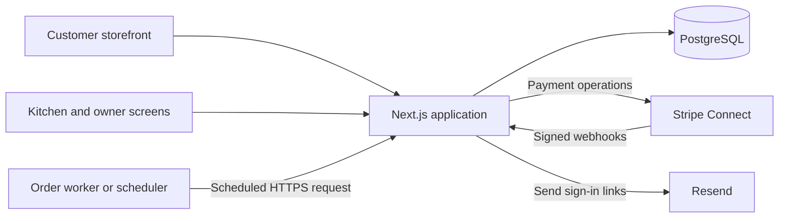

# Siamsil Restaurant

Multi-tenant restaurant ordering platform with a storefront, staff kitchen queue, Stripe Connect payments, and owner controls for menus, hours, pricing, and reports.

## Architecture

Siamsil-SROS is a **modular monolith**. One Next.js application serves the customer storefront, kitchen, owner screens, and HTTP APIs. PostgreSQL holds order and payment state and enforces restaurant-level isolation.



| Component | Responsibility | Stack |
| --- | --- | --- |
| Application | Routes, access checks, menu management, checkout, kitchen workflow, and reports | Next.js App Router, React, TypeScript |
| Data | Restaurants, menus, orders, payment history, sessions, and shared rate limits | PostgreSQL 16, Drizzle, SQL migrations |
| Payments and email | Connected-account card authorizations, captures and refunds, plus staff sign-in email | Stripe Connect, Resend |
| Order maintenance | Release unanswered card holds, reconcile pending refunds, and purge expired runtime data | Node.js worker or managed scheduler calling a protected route |

See the [architecture guide](docs/architecture.md) for checkout and sign-in flows, tenant isolation, and scaling trade-offs.

## Run it

Requires Node 22+ and PostgreSQL 16.

```bash
npm install
cp .env.example .env            # edit passwords for anything beyond local development

# One-time database setup (as a Postgres superuser)
#   create role siamsil_owner login password '...' createdb;
#   create role siamsil_app   login password '...';
#   create database siamsil owner siamsil_owner;

npm run db:migrate              # applies db/migrations using the owner role
npm run db:seed                 # demo restaurant + owner login (SEED_OWNER_EMAIL)
npm run dev                     # http://localhost:3000, sign in at /login
npm test                        # needs a second database named siamsil_test (same roles)
```

In development the sign-in link is printed in the server console instead of being emailed.

## How tenant isolation works

- The running app connects as `siamsil_app`, which does not own the tables, so row-level security applies to it.
- Restaurant queries run inside `withTenant(restaurantId, ...)` in `lib/db.ts`, which sets `app.restaurant_id` for that transaction only. No tenant set means no rows.
- Composite foreign keys `(id, restaurant_id)` stop a row from pointing at another restaurant's row.
- Every restaurant gets a default location. Checkout records that location on new orders.
- The app role cannot create or delete restaurants. Use the owner connection or admin tooling.
- `tests/tenant-isolation.test.ts` proves the above against a real database.

## API (all under /api)

| Route | Who | Purpose |
| --- | --- | --- |
| POST auth/request | public, rate limited | Email a one-time sign-in link |
| GET auth/verify?token= | public | Show sign-in confirmation |
| POST auth/verify | public | Spend the link and set the session cookie |
| POST auth/logout | signed in | End the session |
| GET staff/me | staff | Who am I |
| GET staff/menu | staff | Full menu with items and modifiers |
| POST, PUT, DELETE staff/menu/categories[/id] | owner | Categories |
| POST, PUT, DELETE staff/menu/items[/id] | owner | Items (delete is soft) |
| PATCH staff/menu/items/id/availability | staff | Mark sold out or back in stock |
| POST staff/menu/items/id/modifier-groups | owner | Add a modifier group |
| PUT, DELETE staff/menu/modifier-groups/id | owner | Edit or remove a group |
| POST staff/menu/modifier-groups/id/options | owner | Add an option |
| PUT, DELETE staff/menu/modifier-options/id | owner | Edit or remove an option |
| GET r/slug/menu | public | Storefront menu, open/closed state, earliest pickup |
| GET r/slug/pickup-slots | public | 15-minute pickup times (empty when paused or closed) |
| POST r/slug/quote | public, rate limited | Price a cart on the server: subtotal, tax, tip, total |
| GET staff/settings | staff | Ordering settings |
| PATCH staff/settings | staff (pause) / owner (rest) | Pause ordering, prep time, advance days, tax rate |
| GET, PUT staff/hours | staff / owner | Weekly opening periods |
| POST r/slug/checkout | public, rate limited | Start checkout. Reuse `Idempotency-Key` and any `Checkout-Session` header for an identical retry |
| GET orders/token | private link | Customer's order status (polled every 5 seconds) |
| POST webhooks/stripe | Stripe signature | Payment events, de-duplicated |
| GET staff/orders?offset= | staff | Paginated waiting, accepted and ready orders |
| POST staff/orders/id/accept, decline | staff | Accept (with optional `prepMinutes`) captures the money; decline releases the hold |
| POST staff/orders/id/ready, complete | staff | Kitchen line: accepted, ready, picked up |
| POST staff/orders/id/cancel | owner | Cancel an accepted order and refund in full, including the SROS fee |
| GET staff/pricing?monthlySalesCents=&avgOrderCents= | owner | Plans, the active one, and each plan's monthly cost estimate |
| PUT staff/pricing | owner | Choose a plan; applies to new orders only |
| GET staff/reports/summary?days= | owner | Sales, tax, tips, fees, refunds, top items, by day |
| POST internal/expire-orders | `CRON_SECRET` | Release orders unanswered after 5 minutes. Call every minute |

## Decisions made in Sprint 1

- Data access: Drizzle with SQL migrations as the source of truth (no engine download, simple to inspect).
- Login: emailed one-time link, hashed tokens, 15-minute links, 30-day sessions.
- Staff roles: `owner` manages the menu, `staff` can read it and mark items sold out.

## Before any live use

- Set an HTTPS `APP_URL`, a `RESEND_API_KEY`, and a verified Resend sender in `LOGIN_FROM_EMAIL`. A mail link opens a confirmation page and is spent only after submitting it.
- Run migrations during the deployment window before replacing the old app. The auth migration revokes the old runtime role's direct table access.
- Generate independent random values of at least 32 characters for `ORDER_TOKEN_SECRET` and `CRON_SECRET`. Keep the order secret stable for retries.
- Set `TRUSTED_CLIENT_IP_HEADER` to a single-IP header owned and overwritten by your ingress. When no trusted IP is available, public rate limits share an anonymous bucket. Redact bearer tokens in sign-in and order paths from production access logs.
- Run `npm run worker:orders` under a process supervisor, or use a managed scheduler to call the expiry endpoint every minute. The worker also reconciles pending Stripe refunds and purges expired sessions, login links and rate-limit records. Monitor worker logs and failed webhook deliveries.
- Owners can edit menus, modifier options, weekly hours, and ordering settings at `/manage`.

## Decisions made in Sprint 2

- The storefront lives at `/r/<slug>`. Prices are never trusted from the browser; `lib/cart.ts` prices from the live menu.
- Tax is rounded half up on the food subtotal. Tips are not taxed.
- Pickup slots are every 15 minutes, from now plus prep time, inside opening hours, in the restaurant's time zone (daylight saving tested).
- Any staff member can pause online ordering; only owners change hours, prep time and tax rate.
- The cart is kept in the browser's local storage.

## Decisions made in Sprint 3

- Stripe Connect direct charges: the payment lives on the restaurant's own account and SROS takes an application fee. Cards are authorized first and captured when the kitchen accepts.
- Fee base is the food subtotal. With direct charges the restaurant's own account pays Stripe, so the "all-in" model takes the target percentage minus estimated processing (never below zero). The exact calculation is saved on every order.
- The kitchen has 5 minutes to accept. After that the hold is released automatically.
- Tips are optional, untaxed, and not part of the fee base.
- Guest checkout needs only a name and phone. The customer's order link is derived from the saved order's server-generated ID. Only its hash is stored. An identical checkout retry returns the same link.
- Webhook events are recorded in the same transaction that applies them, so repeats are ignored and failures can be retried.
- `PAYMENTS_PROVIDER=fake` runs everything locally with a test panel instead of a card form. It refuses to start in production.

## To run against the Stripe sandbox

1. Create a Stripe test account and enable Connect. Create a test connected account for the demo restaurant and save its id in `restaurants.stripe_account_id`.
2. Put the test secret and publishable keys in `.env`, and set `PAYMENTS_PROVIDER=stripe`.
3. Add a Connect webhook endpoint for `/api/webhooks/stripe` listening to `payment_intent.amount_capturable_updated`, `payment_intent.succeeded`, `payment_intent.canceled` `payment_intent.payment_failed`, `refund.created`, `refund.updated`, and `refund.failed`. Put its signing secret in `STRIPE_WEBHOOK_SECRET`. For local testing use `stripe listen --forward-connect-to`.
4. Run the order worker, or schedule `POST /api/internal/expire-orders` every minute with `Authorization: Bearer $CRON_SECRET`.

Before taking live payments, verify card decline and retry, delayed webhook delivery, manual capture, order expiry, and app-initiated full refunds in the Stripe sandbox. Operational reports record captures and confirmed in-app refunds when they occur. Partial refunds and refunds issued outside the app require reconciliation against Stripe.

## Sprint 4: kitchen screen

- `/kitchen` shows new orders with a response countdown, accept with a prep time, mark ready, picked up, and (owners) cancel with a full refund.
- Sound: browsers only allow audio after a tap, so staff press "Turn on sound" once per session. A double beep repeats every 8 seconds while any order is waiting, and the tab title shows the count.
- Staff can pause or resume online ordering from the same screen.
- The screen polls every 4 seconds. Realtime push (server-sent events) is a later improvement; polling is simpler and survives dropped connections.
- Printing and a dedicated tablet mode are not built yet.

## Sprint 5: pricing plans and reports

- Plans live in `lib/pricing.ts`: simple 3% + card fees, all-in 6%, founding 7% all-in, and a growth plan (5% + card fees + $79/month) that is listed but cannot be chosen until monthly billing exists. All rates are experiments.
- Owners choose their own plan at `/pricing`, with a calculator for their monthly sales. The choice applies to new orders only. Each order stores a fee snapshot including the plan, so changing a plan or a rate never rewrites history.
- `/reports` (owners only) shows sales, tax, tips, SROS fees, estimated card fees, refunds, top items and a daily breakdown. Card fees are estimated at 2.9% + 30 cents; Stripe has the exact figures.
- `npm run report:platform -- 30` prints what SROS earned across all restaurants in the last 30 days. It uses the owner database connection, so run it only on your own machine or server.

**Worth knowing about the all-in plans.** With Stripe direct charges the restaurant's own account pays the card fees, so on an all-in plan SROS keeps only the target percentage minus those fees, and nothing on very small orders. On a $20 order at 6% that is about $0.32. Plans with "+ card fees" earn more per order but cost the restaurant more. Compare them in the pilot before settling on a price.
