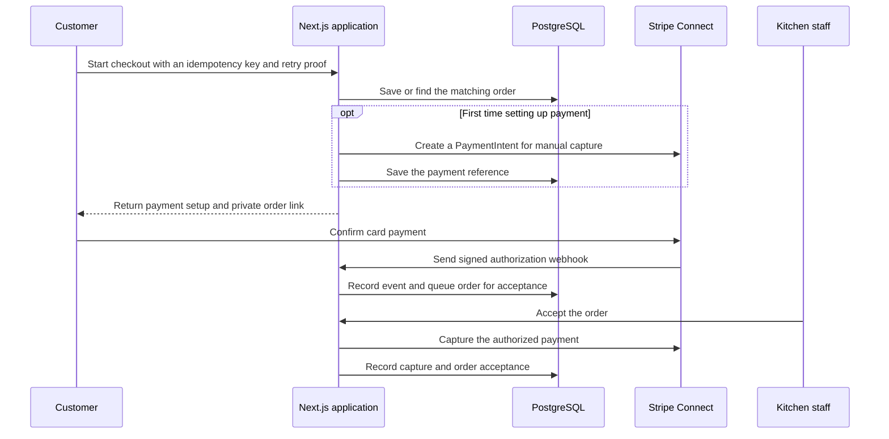
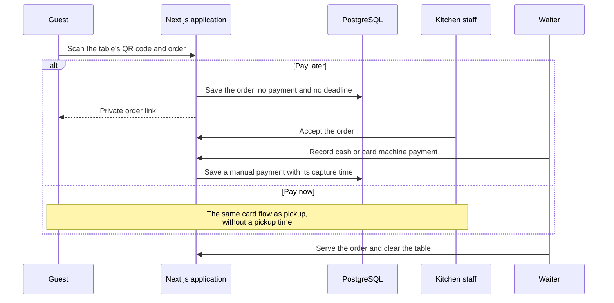

# Siamsil Restaurant architecture

Siamsil Restaurant (formerly STEOS and, before that, SROS) is a multi-tenant platform that today runs restaurant ordering. Customers order for pickup from a restaurant's storefront or from their seat by scanning a table's QR code, paying by card or at the table. Staff run the kitchen, the table board and a till, and owners manage the menu, photos, hours, promotions, pricing and reports. Everything runs in a single Next.js application. TypeScript modules provide shared pricing, scheduling, order and payment logic. PostgreSQL is the system of record for orders, payment history and photos, and Stripe Connect processes card payments on each restaurant's connected account.

This guide describes the application with every integration step in place: the audited payment and sign-in work, photos and the menu editor, tables and dine-in, the till and promotions, the dashboard, and the design system. [`docs/PHASE_4_INTEGRATION.md`](PHASE_4_INTEGRATION.md) records how and in what order those arrived.

## Application boundaries

| Area | Responsibility | Entry points |
| --- | --- | --- |
| Customer storefront | Browse the menu, choose pickup, apply a promo code, request a quote, open checkout, and track the order | [Storefront](../app/r), [checkout and quote routes](../app/api/r), [order status](../app/order) |
| Table ordering | Order from a seat by scanning a table's QR code, pay now or at the table, and ask a waiter for help | [Table page](../app/t), [table routes](../app/api/t) |
| KDS | Accept or decline new orders, move them to ready and served, and refund | [Kitchen](../app/kitchen) |
| Tables and till | The live table board, QR cards, in-person payments, and orders entered by staff | [Tables](../app/tables), [till](../app/pos), [staff API](../app/api/staff) |
| Owner tools | Menu and photos, hours and ordering settings, promo codes, pricing plans, and sales reports, according to role | [Menu](../app/menu), [hours and settings](../app/manage), [promos](../app/promos), [pricing](../app/pricing), [reports](../app/reports) |
| Dashboard and orders | Live counts, performance against the previous period, and searchable order history | [Dashboard](../app/dashboard), [orders](../app/orders) |
| Business logic | Price carts and discounts from the current menu, calculate pickup slots in the restaurant's time zone, coordinate order and payment transitions, and build reports | [Cart](../lib/cart.ts), [hours](../lib/hours.ts), [orders](../lib/orders.ts), [tables](../lib/tables.ts), [till](../lib/pos.ts), [promos](../lib/promos.ts), [fees](../lib/fees.ts), [reports](../lib/reports.ts) |
| Photos | Validate, store and serve menu photos | [Images](../lib/images.ts), [image routes](../app/api/images) |
| External providers | Create and manage Stripe payments, verify payment events, and send sign-in links through Resend | [Payment adapters](../lib/payments), [Stripe webhook](../app/api/webhooks/stripe/route.ts), [mailer](../lib/mailer.ts) |
| Data and maintenance | Apply tenant-scoped transactions, run migrations, and perform scheduled order, refund and cleanup work | [Database connection](../lib/db.ts), [migrations](../db/migrations), [worker](../scripts/order-worker.mjs) |
| Observability | Structured logs, throttled alerts and a health check | [Logging](../lib/log.ts), [alerts](../lib/alerts.ts), [health](../app/api/health/route.ts) |

## Tenant isolation and access

- **A restaurant's storefront look is data.** `restaurants.branding` (JSON) holds its colors, a logo under `public/brands/`, a tagline, favorite dishes and a menu search box. `lib/restaurant-branding.ts` validates it (hex colors only, logo path under `/brands/`; anything invalid is ignored, so a bad row falls back to the default look) and builds the scoped CSS. Only `brand` is required per color mode; hover, text, tint and dark colors are derived when missing, and explicit values always win. The owner edits it in **Hours & settings → Storefront look** (`/manage`, API `PUT /api/staff/branding`, owner-only): brand color, an optional dark-mode color, a tagline, menu search and up to eight favorite dishes, with a light and dark preview. Colors that would be hard to read (under 3:1 contrast with the page) are refused. The editor keeps the logo, which is a file under `public/brands/` set up by us, and keeps a hand-tuned palette unless the owner changes that color. This is the restaurant's brand and is separate from the platform's Siamsil brand in `lib/branding.ts`.
- **Light and dark for Siamsil's own screens.** Dark is midnight navy with the gold accent (tokens in `app/ds.css`, checked for WCAG contrast by `tests/appearance.test.ts`). Each person can press **Theme** in the sidebar (or the icon in the phone's top bar) to step through Match device, Light and Dark. The choice is saved in that browser (`steos:appearance`) and applied to `<html data-appearance>` by a small script in `<head>` before the page paints, so it does not flash; a chosen Light wins over a dark device and the reverse. The kitchen screen is always dark and has no button. Restaurant storefronts keep their own look and guests have no setting.
- Staff routes resolve the restaurant and staff role from the session. The public storefront resolves the restaurant by slug, a table page by the secret in its QR code, and the order status API by a hash of the private order token.
- `withTenant()` sets the restaurant ID inside a PostgreSQL transaction. Row-level security uses that ID to restrict row access, and composite foreign keys `(id, restaurant_id)` protect relationships across tenant-scoped tables. That includes the staff member who entered an order, a table's assigned waiter, and a dish's photo, so none of them can point at another restaurant's row.
- The runtime database role has limited privileges, and the table that holds staff sign-in data is not readable by it at all. SQL migrations use a separate owner connection. Narrow `security definer` functions handle everything that starts without a tenant context or needs data the runtime role cannot read. They are written the same way: a fixed search path, schema-qualified names, and execute revoked from everyone but the runtime role.

  | Purpose | Functions |
  | --- | --- |
  | Staff sign-in | `auth_issue_login`, `auth_exchange_login`, `auth_session_staff`, `auth_end_session`, `auth_find_staff` |
  | Public lookups | `public_restaurant_by_slug`, `public_order_by_token`, `public_table_by_token`, `public_image` |
  | Staff names for the table board | `tenant_staff_directory` returns display names only, and only for the current restaurant |
  | Scheduled and shared work | `orders_past_deadline`, `stripe_refunds_due`, `purge_expired_runtime_data`, `prune_orphan_images`, `remove_unused_menu_image`, `record_order_worker_run`, `order_worker_is_healthy`, `touch_table`, `consume_request_budget` |

- **Roles.** Owners manage the menu and photos, hours and ordering settings, floors and tables, promo codes, pricing and reports, and can cancel an order the kitchen already accepted. Staff run the kitchen, the table board and the till, mark dishes sold out, and can pause or resume ordering. A custom discount at the till is owner-only. Every other setting is owner-only too.
- **Sign-in.** Staff receive a one-time email link. Opening it displays a confirmation page. Submitting the form exchanges the token for a session and sets an HTTP-only cookie, so an email scanner that opens the link cannot spend it. Login and session tokens are stored as hashes. The confirmation page is rendered by the server under a strict content policy, so it carries its own small stylesheet.
- **Rate limits** are kept in PostgreSQL so every app instance shares them. Each is keyed by a hash, and a client is identified only by the header named in `TRUSTED_CLIENT_IP_HEADER`; without a trusted address, clients share one bucket.

  | Limit | Allowed |
  | --- | --- |
  | Sign-in requests | 5 per email and 20 per client, per 15 minutes |
  | Price quotes | 60 per client per minute |
  | Checkout | 10 per client per minute |
  | Table checkout | 8 per table per 10 minutes |
  | Waiter and bill requests | 8 per table and 12 per client, per 5 minutes |
  | Wrong promo codes | 8 per client per 10 minutes |
  | Photo uploads | 60 per restaurant per hour |
  | Order status | 120 per client per minute |
  | Table "browsing" signal | 3 per table code per minute |

## Orders

An order has a **type** (`pickup`, `dine_in` or `counter`) and a **payment mode** (`online`, or `pay_later` when the restaurant collects payment in person). Its **status** is one of `pending_payment`, `awaiting_acceptance`, `accepted`, `ready`, `completed`, `declined`, `cancelled`, `expired` or `payment_failed`. Money is recorded on a `payments` row, whose method is an online card, cash, the restaurant's own card machine, or other.

The database enforces the rules that keep the two payment modes apart, so they hold even if application code slips:

- A dine-in order must belong to a table, and a table with order history can be deactivated but never deleted.
- A pay-later order cannot be a pickup order, and it can never carry an acceptance deadline.
- A discount can never exceed the food subtotal.

### Pickup checkout and payment

The server prices the cart and validates pickup eligibility; prices are never taken from the browser. A checkout retry recovers the saved order when its request fingerprint matches, and a reused key with a different order is refused. Stripe webhook handling verifies the signature, then records the event and applies its state transition in one database transaction. Once authorization is recorded, the kitchen has five minutes to accept. Declining or expiring an order releases its hold. The refund flow tracks pending in-app refunds until Stripe confirms the outcome.

### Dine-in and paying at the table

A pay-later order goes straight to the kitchen. There is no card to hold, no countdown and no refund through Stripe, so the expiry sweep (which looks only at orders with a deadline) and refund reconciliation (which looks only at Stripe payments) can never reach it. It also needs no payment provider at all, so these orders work even when Stripe is not configured; only paying by card does. Money taken in person is handed back by staff, not by the provider, so cancelling an accepted order, or declining one paid at the till, records the refund only after staff confirm they have already returned the money. Nothing is recorded as refunded before that, and repeating the confirmation after a lost response is safe. Cancelling is owner-only; declining is a kitchen action, so any staff member can do it. Siamsil's fee on these orders is recorded as invoiced, not taken from a card payment; billing it is not part of the application yet.

The table board derives each table's state (available, browsing, pending, preparing, ready, served, bill, service request, paid) from its orders since the table was last cleared and from open guest requests. A table cannot be cleared while an order is in progress or unpaid. The guest's status page reports payment separately from the order: paid, refunded (money taken in person and handed back, which keeps its original capture time for reports) or unpaid. A cancelled, declined or expired pay-later order says nothing was charged or that the payment was handed back, never mentioning a card hold or card refund, and an ended order never asks the guest to pay.

### The till and promotions

Staff enter an order for a table or a walk-in at the till, and either take payment now or send it to the kitchen to pay later. Till requests use a keyed fingerprint, so a reused request key with a different order is refused and the same request replays safely. Each till order records the staff member who entered it.

A promo code or a custom discount comes off the food first. Tax is charged on what is left, tips are never taxed, and a total cannot go negative. The Siamsil fee is calculated on the food at its full price, so a discount is the restaurant's cost, and the fee is capped at the amount charged. A till request that already succeeded is answered from the order it created before the menu or promo is read again, so a retry still works after a price change or after the code's last use was taken. Looking up a code, redeeming it and creating the order happen in one locked transaction, so the last use of a limited code cannot be taken twice. Each order records which promotion it used by identity, apart from the code text it shows on receipts, so renaming a code still returns the use to the same promotion and a new code that reuses a deleted code's text is never touched. A use is given back when an order never completes (declined, expired, or its payment failed or was cancelled) and taken again if a failed payment is later captured. The code is part of the request fingerprint only when one is used, so orders placed without a code keep matching their stored fingerprints.

## Photos

Photos are stored in PostgreSQL, not on disk, so they are covered by the same row-level security and backups. The browser shrinks a photo to a 1200 pixel JPEG before uploading. The server checks the file's real signature (JPEG, PNG or WebP), refuses anything over 1.5 MB while reading it, and caps a restaurant at 500 photos. Photos are served publicly with a long immutable cache. A photo is deleted when its last dish stops using it, and the order worker removes photos that were never attached after an hour. A dish and its add-on choices are saved together in a single tenant transaction, so a lost response can be repeated safely.

## Reports and the dashboard

Reports date money by when it moved: a sale counts on the day its payment was captured and a refund on the day it was confirmed, not on the day the order was placed. In-person payments carry a capture time, so they are counted the same way. A report shows sales, discounts, tax, tips, refunds, the restaurant's estimated net, and breakdowns by payment method, order type and menu category. Card fees are estimated for online card payments only.

The dashboard headlines sales after refunds and compares them with the period just before. Its daily chart reaches below zero when a day refunded more than it sold, so it adds up to the headline figure, and its live order counts come from the server for the whole restaurant, not from the first page of orders. Order history is a separate, paged and searchable read that never lists an order still waiting on a card.

## Front end

- **Design system.** Every screen uses one stylesheet, [`app/ds.css`](../app/ds.css), scoped to a `.ds` wrapper that each route's layout provides. Customer screens follow the device's light or dark setting, and the kitchen is always dark. The sign-in confirmation page is the one exception, because its content policy forbids external styles.
- **Navigation.** Staff screens share a side menu that is full width on large screens, a collapsible icon rail on tablets, and a compact top bar on phones.
- **Live screens poll.** The kitchen and the table board refresh every four seconds, the dashboard's live counts every eight, and the customer order page every five (and continues past a cancellation until a pending refund settles, and while a served pay-later bill is still unpaid). A table page sends a "browsing" signal about once a minute. A customer's cart is kept in the browser's local storage. Polling keeps the browser flows simple and adds database read traffic with each open screen.
- **Behavior that must hold on these screens** is listed in the integration notes: the kitchen's paging, aborted refreshes and failure messages; the storefront's derived pickup time and per-cart quote; checkout's per-attempt key and retry proof; and the hours editor's server-validated saves.

## Operations and scaling

- **Background work.** Run the Node.js order worker under a supervisor or schedule the same HTTP request every minute. The worker requires HTTPS or a loopback address and a strong shared secret. The maintenance route expires orders past their deadline, reconciles pending Stripe refunds, removes unattached photos, purges expired sessions, login links and rate-limit records, and records a heartbeat. [Worker setup](../README.md#before-any-live-use)
- **Health.** `GET /api/health` returns 503 when the database is unreachable, when the worker's heartbeat is more than five minutes old, when a card order is more than five minutes past its deadline, or, in production, when no trusted client-IP header is configured. Point an uptime monitor at it.
- **Logs and alerts.** Logs are one JSON object per line, and fields that look personal or secret (tokens, email, phone, customer name, card) are redacted. Problems someone should look at now (a payment authorization, capture, hold release or refund failing; order expiry or refund reconciliation failing; a payment webhook failing; the sign-in email not sending; unexpected server errors) are logged and, when `ALERT_WEBHOOK_URL` is set, posted to it. Each alert key is sent at most once every 15 minutes, and unexpected errors are keyed by method and route, so an outage produces one message instead of hundreds. An unexpected error returns a request reference the user can quote.
- **Shared state.** App instances share orders, sessions, rate limits and photos through PostgreSQL. Size database connection pools for the number of app instances and monitor connection usage as traffic grows.
- **Database size.** Photos add to the database and its backups. At up to 1.5 MB and 500 photos per restaurant the worst case is large, but browser shrinking makes a typical photo around 150 KB. If that becomes a problem, moving photos to object storage changes only the image module and the two image routes.
- **Report cost.** A report is computed over its period each time it is opened, and the dashboard computes two (the period and the one before). The live counts use the first page of active orders (up to 100).
- **Deployment.** Apply SQL migrations using the owner connection and run the web app using the restricted connection. Configure and verify Resend, the scheduler, trusted ingress headers, the alert webhook and Stripe Connect test credentials in the target environment, and subscribe the Stripe Connect webhook to the refund events. [Stripe sandbox instructions](../README.md#to-run-against-the-stripe-sandbox)

## Database migrations

| Migration | Adds |
| --- | --- |
| `0001` to `0003` | Restaurants, staff, menu, locations, opening hours and the storefront's public lookups |
| `0004` to `0006` | Orders, payments and webhook de-duplication; the kitchen workflow; pricing plans |
| `0007` | Restricted sign-in access and the shared rate limiter |
| `0008` to `0010` | Checkout request fingerprints and payment history, menu category archiving, Stripe refund reconciliation |
| `0011` | Order worker heartbeat for the health check |
| `0012` | Photos, and the cleanup that keeps a photo until its last dish stops using it |
| `0013` | Floors, tables, guest requests, pay-later orders and manual payments, and the tenant staff directory |
| `0014` | Promo codes, order discounts, the promotion each order used, and the staff member who entered a till order |
| `0015` | Per-restaurant storefront branding (`restaurants.branding`), returned by the public storefront lookup; Zogam Cafe's look moved from code to data |

## Known limits

- Card payments have been exercised in this project only through the built-in fake provider (a simulated card panel that refuses to start in production) and through simulated payment events in tests. That checks the application's own logic. It is not a run against Stripe, so authorization, capture, webhook delivery and refunds still need a real Stripe sandbox run before live use. Partial refunds and refunds made directly in Stripe also need reconciling in Stripe.
- Billing Siamsil's fee on pay-later orders is recorded and reported but not automated.
- Photos live in the database (see above), and there is no light theme for the kitchen.

## Where the modules live

Siamsil is one modular monolith. The module names in [PRODUCT_VISION.md](PRODUCT_VISION.md) are boundaries inside it, not separate services. Today's code maps to them like this, so new work goes in the right place:

| Module | Code |
| --- | --- |
| Core | `db/`, `lib/db.ts`, `lib/branding.ts` (the platform's identity), `lib/auth.ts`, `lib/settings.ts`, `lib/ratelimit.ts`, `lib/log.ts`, `lib/alerts.ts`, `app/login`, `app/manage` |
| Ordering | `lib/cart.ts`, `lib/hours.ts`, `lib/storefront.ts`, `lib/orders.ts`, `lib/menu.ts`, `lib/images.ts`, `app/r`, `app/order`, `app/menu`, `app/api/r` |
| POS | `lib/pos.ts`, `lib/promos.ts`, `app/pos`, receipts under `app/orders` |
| Kitchen | `app/kitchen`, `lib/tables.ts` and `app/tables` (dine-in and table service), `app/t` |
| Payments | `lib/payments/`, `lib/fees.ts`, `lib/pricing.ts`, `app/api/webhooks` |
| Reporting | `lib/reports.ts`, `app/dashboard`, `app/reports` |

A new module gets its own `lib/<module>/` code and `app/<module>/` screens, its own tables (each with a tenant id and a row-level policy), and its own tests. It shares the Core pieces and the design system, and it does not reach into another module's tables directly.
