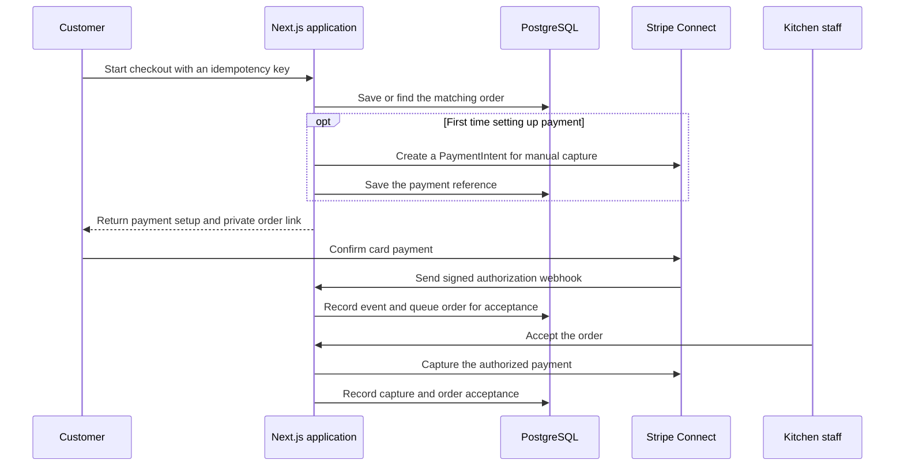

# Siamsil-SROS architecture

Siamsil-SROS is a multi-tenant restaurant ordering platform. Its storefront, staff screens, and API routes run in a single Next.js application. TypeScript modules provide shared pricing, scheduling, order, and payment logic. PostgreSQL is the system of record for the app's orders and payment history, and Stripe Connect processes card payments on each restaurant's connected account.

## Application boundaries

| Area | Responsibility | Entry points |
| --- | --- | --- |
| Customer storefront | Browse the menu, choose pickup, request a quote, open checkout, and track the order | [Storefront](../app/r), [checkout and quote routes](../app/api/r), [order status](../app/order) |
| Staff and owner tools | Run the kitchen queue and manage menus, availability, hours, pricing, and reports according to role | [Kitchen](../app/kitchen), [management](../app/manage), [staff API](../app/api/staff) |
| Business logic | Price carts from the current menu, calculate pickup slots in the restaurant's time zone, and coordinate order and payment transitions | [Cart](../lib/cart.ts), [hours](../lib/hours.ts), [orders](../lib/orders.ts) |
| External providers | Create and manage Stripe payments, verify payment events, and send sign-in links through Resend | [Payment adapters](../lib/payments), [Stripe webhook](../app/api/webhooks/stripe/route.ts), [mailer](../lib/mailer.ts) |
| Data and maintenance | Apply tenant-scoped transactions, run migrations, and perform scheduled order and refund maintenance | [Database connection](../lib/db.ts), [migrations](../db/migrations), [worker](../scripts/order-worker.mjs) |

## Tenant isolation and staff sign-in

- Staff routes resolve the restaurant and staff role from the session. The public storefront resolves the restaurant by slug, and the order status API looks up a hash of the private order token.
- `withTenant()` sets the restaurant ID inside a PostgreSQL transaction. Row-level security uses that ID to restrict row access, and composite foreign keys protect relationships across tenant-scoped tables.
- The runtime database role has limited privileges. SQL migrations use a separate owner connection. Narrow database functions handle operations that start without a tenant context, including login token exchange and public restaurant lookup.
- Staff receive a one-time email link. Opening it displays a confirmation form. Submitting the form exchanges the token for a session and sets an HTTP-only cookie. Login and session tokens are stored as hashes.

## Pickup checkout and payment

The server prices the cart and validates pickup eligibility. A checkout retry can recover the saved order when its request fingerprint matches. Stripe webhook handling verifies the signature, then records the event and applies its state transition in one database transaction. Once authorization is recorded, the kitchen has five minutes to accept. Declining or expiring an order releases its hold. The refund flow tracks pending in-app refunds until Stripe confirms the outcome, and reports use capture and refund timestamps.

## Operations and scaling

- **Background work.** Run the Node.js order worker under a supervisor or schedule the same HTTP request every minute. The app's maintenance route uses a shared secret and handles expired orders, refund reconciliation, and cleanup of expired sessions, login links, and rate-limit records. [Worker setup](../README.md#before-any-live-use)
- **Shared state.** App instances share orders, sessions, and rate limits through PostgreSQL. Size database connection pools for the number of app instances and monitor connection usage as traffic grows.
- **Polling.** The kitchen refreshes its queue about every four seconds and the customer order page about every five seconds. Polling keeps the browser flows simple and adds database-backed read traffic with each open screen.
- **Deployment.** Apply SQL migrations using the owner connection and run the web app using the restricted connection. Configure and verify Resend, the scheduler, trusted ingress headers, and Stripe Connect test credentials in the target environment. [Stripe sandbox instructions](../README.md#to-run-against-the-stripe-sandbox)
